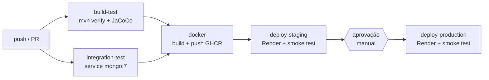

# Projeto - Cidades ESGInteligentes

### CoMed ESG

Copiloto de IA clínica para médicos e pacientes, com o modelo de dados em **MongoDB** organizado
pelos pilares **ESG**. Esta entrega cobre o ciclo DevOps completo: API Spring Boot, testes
automatizados, containerização e pipeline CI/CD com deploy em **staging** e **produção**.

| Collection | Pilar | O que guarda |
|---|---|---|
| `pacientes` | Social | Perfil clínico e social; `vulnerabilidadeSocial` e `dadosClinicos` flexíveis (HbA1c, semana gestacional, cuidador, idioma...) |
| `medicos` | Governança | Credenciamento: `statusCompliance`, treinamento LGPD, validade do CRM (único) |
| `consultas` | Social + Ambiental | Telemedicina (`distanciaEvitadaKm`, `co2EvitadoKg`) ou presencial (`clinica`, deslocamento) |
| `alertas_ia` | Governança | Alertas da IA com `nivelRisco` e `revisadoPorMedico` (humano-no-loop) |
| `auditoria_compliance` | Governança | Trilha LGPD **append-only** (sem update/delete na API) |

**Integrantes (2TDSOC):** Lucas Gabriel Neres Sant'Ana (RM 565612) · Matheus Ferreira da Costa (RM 564003)

**Ambientes publicados** (Render free: o primeiro acesso após inatividade pode levar cerca de 1 min):

| Ambiente | URL |
|---|---|
| Staging | <https://comed-esg-staging.onrender.com> |
| Produção | <https://comed-esg-prod.onrender.com> |

---

## Como executar localmente com Docker

**Pré-requisito:** Docker Desktop (ou Docker Engine + Compose v2). Sem Docker na máquina, use um
GitHub Codespace (abaixo): os mesmos comandos funcionam lá.

```bash
cp .env.example .env            # PowerShell: Copy-Item .env.example .env
# edite o .env e troque as senhas
docker compose up -d --build
docker compose ps               # aguarde comed-api e comed-mongo ficarem "healthy"
```

| Endereço | O que é |
|---|---|
| <http://localhost:8080/> | Página de status (ambiente, versão e indicadores ESG) |
| <http://localhost:8080/api/esg/indicadores> | Indicadores ESG consolidados |
| <http://localhost:8080/swagger-ui.html> | Documentação interativa da API |
| <http://localhost:8080/actuator/health> | Health check (inclui o MongoDB) |
| <http://localhost:8081/> | mongo-express, com `docker compose --profile tools up -d` |

Na primeira subida o seed (`SEED_ENABLED=true`) insere os dados de exemplo: 10 pacientes, 5 médicos,
7 consultas, 8 alertas e 5 eventos de auditoria. Ele só escreve em collections vazias.

```bash
docker compose logs -f api                                     # logs da API
docker compose exec api tail -f /app/logs/comed-esg.log        # log em arquivo (volume api-logs)
docker compose down                                            # para tudo, mantém os dados
docker compose down -v                                         # para tudo e apaga os volumes
```

### Alternativa: GitHub Codespaces (sem Docker local)

Quando o Docker não sobe na máquina (virtualização desligada na BIOS, Windows sem Hyper-V/WSL 2 etc.),
o compose roda igual num Codespace, que já vem com Docker e Compose v2.

1. No repositório no GitHub: **Code** → aba **Codespaces** → **Create codespace on main**.
2. No terminal do Codespace, os mesmos comandos de antes:

   ```bash
   cp .env.example .env            # edite o .env e troque as senhas
   docker compose up -d --build
   docker compose ps               # aguarde comed-api e comed-mongo ficarem "healthy"
   ```

3. Na aba **Ports**, a porta `8080` aparece encaminhada: clique no ícone de globo para abrir a página
   de status. A URL é do tipo `https://<nome-do-codespace>-8080.app.github.dev/` e substitui o
   `http://localhost:8080` da tabela acima (o mesmo vale para a `8081` do mongo-express).

Ao terminar, `docker compose down` e pare o Codespace (**Codespaces** → **Stop codespace**) para não
consumir a cota gratuita de horas.

**Principais endpoints** (todos em `/api`):

| Recurso | Endpoints |
|---|---|
| Pacientes | CRUD em `/pacientes` · `GET /pacientes/vulneraveis` |
| Médicos | CRUD em `/medicos` · `GET /medicos/pendencias-compliance` |
| Consultas | CRUD em `/consultas` (CO2 calculado se a teleconsulta só informar a distância) |
| Alertas | CRUD em `/alertas` · `GET /alertas/pendentes` · `PATCH /alertas/{id}/revisao?medico=...` |
| Auditoria | `GET` e `POST /auditoria` · `GET /auditoria/paciente/{nome}` |
| ESG / Info | `GET /esg/indicadores` · `GET /info` |

Regras automáticas: excluir um paciente grava `exclusao_dados` na auditoria; revisar um alerta grava
`revisao_alerta_ia`; `co2EvitadoKg = distância × 2 (ida e volta) × 0,13 kg/km` (configurável).

**Sem Docker** (só para desenvolvimento): Java 21 e um MongoDB em `localhost:27017`:

```bash
./mvnw spring-boot:run                                   # Windows: mvnw.cmd spring-boot:run
./mvnw verify                                            # testes unitários + cobertura
MONGODB_URI=mongodb://localhost:27017/comed ./mvnw verify -Pintegration   # + integração
```

---

## Pipeline CI/CD

Ferramenta: **GitHub Actions** ([`.github/workflows/ci-cd.yml`](.github/workflows/ci-cd.yml)).
Imagens no **GitHub Container Registry**; ambientes no **Render**; banco no **MongoDB Atlas**.



| Job | Quando roda | O que faz |
|---|---|---|
| `build-test` | push em `main`/`develop`, PR para `main`, manual | `./mvnw -B verify`: compila, roda 75 testes unitários e `@WebMvcTest`, gera o JaCoCo. Publica os relatórios como artifact e o resumo dos testes na página da execução |
| `integration-test` | idem | Sobe `mongo:7` como *service container* e roda `./mvnw -B verify -Pintegration` (failsafe, `*IT.java`) |
| `docker` | só **push na `main`**, após os dois anteriores | Login no GHCR com o `GITHUB_TOKEN`, `docker build --build-arg APP_VERSION=<sha>`, push de `:<sha>` e `:latest` |
| `deploy-staging` | após `docker` | Environment `staging`. Chama o Deploy Hook do Render com `imgURL=ghcr.io/matheus-costa2004/comed-esg:<sha>` e faz o **smoke test** |
| `deploy-production` | após staging **+ aprovação** | Environment `production` com *Required reviewers*. Mesmo processo com o hook de produção |

**Smoke test:** consulta `/api/info` a cada 15 s por até 12 min (cold start do Render free) até
`versao` ser igual ao SHA do commit, e depois exige `/actuator/health` = `UP`. Assim o pipeline só fica
verde quando **a versão nova está de fato no ar**, e não apenas quando o deploy foi disparado.

| Configuração | Tipo | Onde |
|---|---|---|
| `RENDER_DEPLOY_HOOK_STAGING` / `RENDER_DEPLOY_HOOK_PROD` | Secret | Environments `staging` / `production` |
| `STAGING_URL` / `PROD_URL` | Variable | Environments `staging` / `production` |
| `MONGODB_URI`, `APP_ENV`, `SPRING_PROFILES_ACTIVE`, `SEED_ENABLED` | Env var | Cada serviço no Render |

| Ambiente | Serviço Render | Database Atlas | Profile Spring | Selo na página |
|---|---|---|---|---|
| local | — (docker-compose) | container `mongo` | padrão | cinza |
| staging | `comed-esg-staging` | `comed_staging` | `staging` (logs DEBUG) | âmbar |
| produção | `comed-esg-prod` | `comed_prod` | `prod` (logs WARN) | verde |

O passo a passo de configuração está em [`docs/SETUP.md`](docs/SETUP.md).

---

## Containerização

[`Dockerfile`](Dockerfile):

```dockerfile
# syntax=docker/dockerfile:1

# Build: compila o JAR com Maven e JDK 21
FROM maven:3.9-eclipse-temurin-21 AS build
WORKDIR /build

# Cache das dependências do Maven
COPY pom.xml .
RUN mvn -B -q dependency:go-offline

COPY src ./src
# Os testes já rodaram no pipeline
RUN mvn -B -q package -DskipTests \
 && java -Djarmode=tools -jar target/comed-esg.jar extract --layers --launcher --destination target/extracted

# Runtime: só a JRE, sem Maven nem código-fonte
FROM eclipse-temurin:21-jre-alpine

# O pipeline passa o SHA do commit, exibido em /api/info
ARG APP_VERSION=dev
ENV APP_VERSION=${APP_VERSION} \
    PORT=8080 \
    JAVA_OPTS="-XX:MaxRAMPercentage=75"

# Roda como usuário sem privilégios
RUN addgroup -S comed && adduser -S -G comed comed \
 && mkdir -p /app/logs && chown -R comed:comed /app
WORKDIR /app

# Camadas do Spring Boot, da que menos muda para a que mais muda
COPY --from=build --chown=comed:comed /build/target/extracted/dependencies/ ./
COPY --from=build --chown=comed:comed /build/target/extracted/spring-boot-loader/ ./
COPY --from=build --chown=comed:comed /build/target/extracted/snapshot-dependencies/ ./
COPY --from=build --chown=comed:comed /build/target/extracted/application/ ./

USER comed
EXPOSE 8080

HEALTHCHECK --interval=30s --timeout=5s --start-period=60s --retries=3 \
  CMD wget -qO- "http://localhost:${PORT}/actuator/health" | grep -q '"status":"UP"' || exit 1

# exec deixa o Java como PID 1 para receber o SIGTERM
ENTRYPOINT ["sh", "-c", "exec java $JAVA_OPTS org.springframework.boot.loader.launch.JarLauncher"]
```

**Estratégias adotadas**

| Estratégia | Por quê |
|---|---|
| **Multi-stage** (Maven/JDK → JRE Alpine) | A imagem final não leva Maven, JDK nem código-fonte: fica menor e com menos superfície de ataque |
| **Cache de dependências** (`pom.xml` + `go-offline` antes do `src`) | Mudar só o código não invalida a camada de dependências; builds seguintes são bem mais rápidos |
| **Camadas do Spring Boot** (`jarmode=tools extract --layers`) | Dependências e aplicação viram camadas separadas; um commit comum reenvia só a camada pequena da aplicação ao GHCR |
| **Usuário não-root** (`comed`) | Se a aplicação for comprometida, o processo não tem privilégios de root no container |
| **`APP_VERSION` via build-arg** | A imagem carrega o SHA do commit; `/api/info` o expõe e o smoke test usa para confirmar o deploy |
| **`-XX:MaxRAMPercentage=75`** | A JVM respeita o limite de memória do container (512 MB no Render free) em vez da RAM do host |
| **`HEALTHCHECK`** no Actuator | Docker/Compose sabem quando a API está pronta de verdade (inclui a conexão com o MongoDB) |
| **Configuração por variáveis de ambiente** | A mesma imagem roda em local, staging e produção; só mudam as variáveis |
| **`.dockerignore`** | Só `pom.xml` e `src/` entram no contexto: build mais rápido e sem vazar `.env` |

**Orquestração local** ([`docker-compose.yml`](docker-compose.yml)):

| Item | Configuração |
|---|---|
| Serviços | `mongo` (mongo:7, healthcheck `mongosh ping`), `api` (build local, `depends_on: service_healthy`, healthcheck próprio), `mongo-express` (profile `tools`, porta 8081) |
| Volumes nomeados | `mongo-data` → `/data/db` (dados do banco) · `api-logs` → `/app/logs` (log em arquivo da API) |
| Rede | `comed-net` (bridge): a API alcança o banco pelo nome `mongo` |
| Variáveis | Todas as credenciais vêm do `.env` (modelo em [`.env.example`](.env.example)); o compose falha com mensagem clara se faltar alguma |
| Portas | API em `${API_PORT:-8080}`; MongoDB e mongo-express publicados só em `127.0.0.1` |

---

## Prints do funcionamento

**1. Pipeline: visão geral dos jobs**


**2. Job de build e testes**


**3. `mvn verify` com os testes passando**


**4. Resumo dos testes**


**5. Imagem publicada no GHCR**


**6. Aprovação manual da produção**


**7. Deploy no Render: staging**


**8. Deploy no Render: produção**


**9. Página de status em staging**


**10. Página de status em produção**


**11. `/api/esg/indicadores` em produção**


**12. Swagger UI**


**13. `docker compose up` local**


**14. `docker compose ps` local**


**15. Aplicação rodando localmente**


**16. MongoDB Atlas com os dois databases**


**17. Environments do GitHub (revisores da produção)**


---

## Tecnologias utilizadas

| Camada | Tecnologia |
|---|---|
| Linguagem e framework | Java 21, Spring Boot 3.5.16 (Web, Data MongoDB, Validation, Actuator) |
| Banco de dados | MongoDB 7 (local, em container) e MongoDB Atlas (staging e produção) |
| Documentação da API | springdoc-openapi 2.8 (Swagger UI) |
| Build | Maven 3.9 (via Maven Wrapper) |
| Testes | JUnit 5, Mockito, Spring MockMvc (`@WebMvcTest`), `@SpringBootTest`, Surefire + Failsafe |
| Cobertura | JaCoCo |
| Containers | Docker (multi-stage), Docker Compose, Eclipse Temurin 21 JRE Alpine |
| CI/CD | GitHub Actions, GitHub Container Registry (GHCR), GitHub Environments |
| Hospedagem | Render (Web Services a partir de imagem) |

---

## Checklist de entrega

| Item | OK |
|---|---|
| Projeto compactado em .ZIP com estrutura organizada | ✅ |
| Dockerfile funcional | ✅ |
| docker-compose.yml ou arquivos Kubernetes | ✅ |
| Pipeline com etapas de build, teste e deploy | ✅ |
| README.md com instruções e prints | ✅ |
| Documentação técnica com evidências (PDF ou PPT): [`docs/CoMed_ESG_Documentacao_DevOps.pdf`](docs/CoMed_ESG_Documentacao_DevOps.pdf) | ✅ |
| Deploy realizado nos ambientes staging e produção | ✅ |
